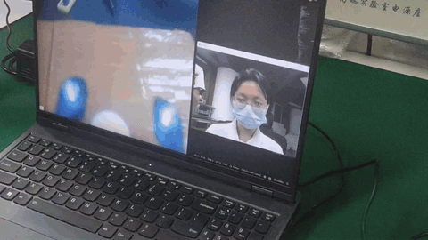

# EyeDetect

基于单目摄像头的实时人脸注视方向检测项目，结合 MediaPipe 与 ETH-XGaze ResNet18 估计人脸位置、头部姿态和注视方向，并通过 OpenCV 实时可视化结果。

## 演示

<p align="center">
  
</p>

## 核心流程

```text
摄像头帧
  ↓
OpenCV 图像采集
  ↓
MediaPipe FaceMesh 人脸关键点检测
  ↓
3D 人脸模型与头部姿态估计
  ↓
头部姿态归一化 + ETH-XGaze ResNet18
  ↓
注视角度 / 注视向量 / 摄像头注视判断
  ↓
OpenCV 可视化与偏移提醒
```

## 主要功能

- 支持摄像头实时读取和多人脸检测，当前配置最多检测 3 张人脸。
- 输出人脸边界框、头部 `pitch/yaw/roll`、注视 `pitch/yaw`、注视向量和人脸到摄像头的距离。
- 提供 `look_at_camera()` 判断，用于判断目标是否大致注视摄像头。
- 使用 `PyGazeRenderer` 在画面中绘制人脸框和注视方向向量。
- `main.py` 中包含注视偏移持续时间提醒逻辑，可用于专注度或视线偏移检测场景。

## 工程结构

```text
EyeDetect/
├── main.py                         # 摄像头入口与实时推理循环
├── requirements.txt                # 基础依赖
├── 演示视频.gif                    # 项目演示动画
└── pygaze/
    ├── pygaze.py                   # PyGaze 推理接口与结果封装
    ├── gaze_estimator.py            # 人脸、头姿和注视估计流程
    ├── transforms.py                # 输入图像预处理
    ├── utils.py                     # 配置及通用工具
    ├── models/                      # ETH-XGaze 模型构建
    ├── common/                      # 摄像头、人脸、关键点和几何计算
    ├── head_pose_estimation/        # MediaPipe 关键点与头部姿态归一化
    ├── config/eth-xgaze.yaml        # 推理模式、设备和模型配置
    └── data/
        ├── calib/sample_params.yaml # 摄像头参数
        └── normalized_camera_params/ # 归一化摄像头参数
```

## 输出结果

同时在窗口中绘制人脸框和注视向量，用于实时观察检测效果。
